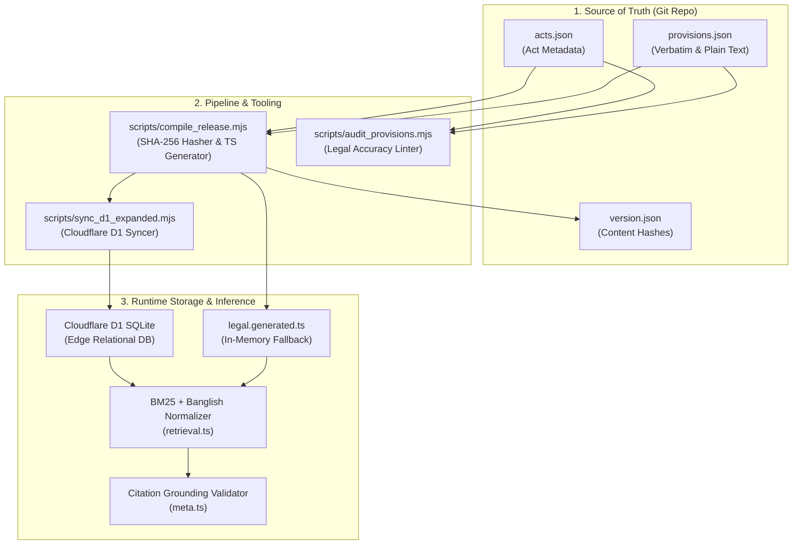
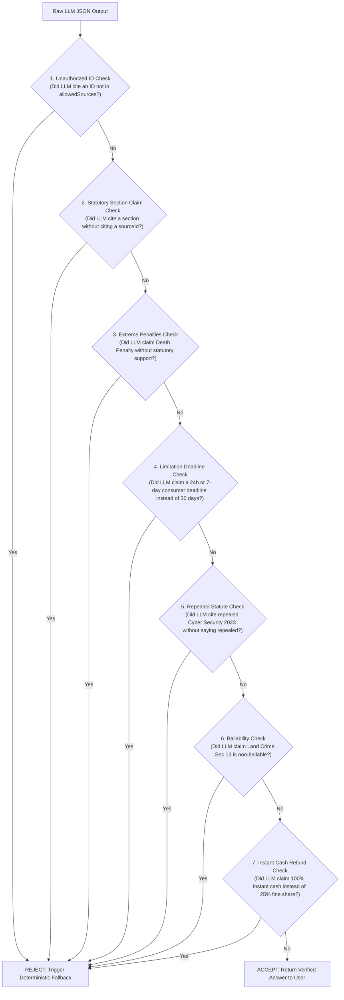

# MyLaws Database Structure & AI Expansion Specification

> **Target Audience:** AI Engineering Agents, Data Pipeline Engineers, Legal Tech Developers  
> **Purpose:** Canonical blueprint of the MyLaws Bangladesh Legal Knowledge Base. Defines schemas, retrieval engineering principles, citation validation guardrails, and the exact Standard Operating Procedure (SOP) for expanding the database with new statutes and provisions.

---

## 1. Executive Summary & Design Philosophy

The MyLaws database is not a passive text repository; it is a **high-precision, ground-truth knowledge graph** engineered to eliminate LLM hallucinations, support phonetic Banglish queries, and ensure 100% legal citation validity.

### The Three-Layer Storage Architecture
The knowledge base exists in three synchronized layers:
1. **Source of Truth (Disk Corpus):** `src/data/corpus/acts.json` and `src/data/corpus/provisions.json`. Modular, version-controlled JSON files carrying SHA-256 content hashes.
2. **Edge Operational Database (Cloudflare D1 SQLite):** Distributed serverless SQLite holding relational tables (`acts`, `provisions`, `offices`, `users`, `user_queries`, `corpus_metadata`).
3. **Zero-Latency In-Memory Compiled Cache:** `src/data/legal.generated.ts`. Precompiled TypeScript objects enabling instant deterministic fallbacks when external networks or LLM APIs time out.



---

## 2. Complete Entity Schemas & Field Specifications

### 2.1 The Act Entity (`acts.json` / `acts` table)
Represents a primary statute, ordinance, or constitutional document gazetted by the Government of Bangladesh.

#### JSON Structure:
```json
{
  "id": "act_labour_2006",
  "name": {
    "en": "Bangladesh Labour Act, 2006",
    "bn": "বাংলাদেশ শ্রম আইন, ২০০৬"
  },
  "actNumber": "XLII of 2006",
  "year": 2006,
  "categories": ["work"],
  "officialUrl": "https://bdlaws.minlaw.gov.bd/act-957.html",
  "legalStatus": "active",
  "notes": {
    "en": "Consolidated code governing employment, wages, working hours, safety, and trade unions.",
    "bn": "শ্রমিক নিয়োগ, মজুরি, কর্মঘণ্টা, কর্মস্থলের নিরাপত্তা ও ট্রেড ইউনিয়ন সংক্রান্ত সমন্বিত আইন।"
  }
}
```

#### Field Rules:
| Field | Type | Required | Description & Validation Rules |
|---|---|:---:|---|
| `id` | `string` | **Yes** | Unique slug prefixed with `act_`, lowercase with underscores (e.g., `act_penal_code_1860`). |
| `name.en` | `string` | **Yes** | Official gazetted title in English. |
| `name.bn` | `string` | **Yes** | Official gazetted title in Bengali. |
| `actNumber` | `string` | No | Gazette enactment number (e.g., `Act No. 42 of 2006` or `1972`). |
| `year` | `number` | **Yes** | 4-digit calendar year of enactment. |
| `categories` | `string[]` | **Yes** | Array of 1 or more canonical categories: `work`, `threats`, `digital`, `consumer`, `land`, `family`, `rights`. |
| `officialUrl` | `string` | **Yes** | Permanent URL on `https://bdlaws.minlaw.gov.bd/act-XXX.html`. |
| `legalStatus` | `string` | **Yes** | Either `"active"`, `"amended"`, or `"repealed"`. |
| `notes` | `object` | No | Bilingual high-level scope description. |

---

### 2.2 The Provision Entity (`provisions.json` / `provisions` table)
The foundational unit of statutory authority. Represents a specific section, article, or rule.

#### JSON Structure:
```json
{
  "id": "labour-123",
  "actId": "act_labour_2006",
  "sectionNumber": "Section 123",
  "categories": ["work"],
  "title": {
    "bn": "মজুরি পরিশোধের সময়সীমা",
    "en": "Time of payment of wages"
  },
  "originalText": "কোন শ্রমিকের মজুরি যে মজুরি মেয়াদের জন্য প্রদেয়, সেই মেয়াদের সমাপ্তির পরবর্তী সাত কার্যদিবসের মধ্যে তাহা পরিশোধ করিতে হইবে...",
  "originalLanguage": "bn",
  "plainExplanation": {
    "bn": "শ্রম আইনের ১২৩ ধারা অনুযায়ী, মাস শেষ হওয়ার পরবর্তী ৭ কার্যদিবসের মধ্যে শ্রমিকের সম্পূর্ণ মজুরি পরিশোধ করা মালিকের জন্য বাধ্যতামূলক।",
    "en": "Under Section 123 of the Labour Act, employers are strictly required to pay all wages within 7 working days following the end of the wage period."
  },
  "caution": {
    "bn": "দেরি হলে প্রথমে ডিআইএফই (DIFE) পরিদর্শকের কাছে লিখিত অভিযোগ করুন (হটলাইন ১৬১০৪); নির্ধারিত সময় পার হলে সরাসরি লেবার কোর্টে বকেয়া মজুরির দাবি জানানো যায়।",
    "en": "File a written conciliation petition with the DIFE Inspector (Hotline 16104); once the deadline lapses, formal claims can be submitted to the Labour Court."
  },
  "sourceUrl": "https://bdlaws.minlaw.gov.bd/act-957/section-29851.html",
  "retrievalDate": "2026-10-30",
  "effectiveDate": "2006-10-11",
  "legalStatus": "active",
  "reviewStatus": "verified",
  "contentHash": "5a4d70df04...",
  "keywords": [
    "unpaid salary", "unpaid wages", "salary delay", "wage payment deadline",
    "beton deynai", "betan deyna", "bakir beton", "বেতন বাকি", "বকেয়া বেতন",
    "মজুরি পরিশোধ", "৭ কার্যদিবস", "শ্রম আইন ১২৩", "ডিআইএফই অভিযোগ"
  ],
  "relatedProvisions": ["labour-5", "labour-132"]
}
```

#### Field Rules & Why They Matter for AI:
| Field | Type | AI Search & Grounding Significance |
|---|---|---|
| `id` | `string` | **Canonical Reference Anchor.** Used by the LLM in `sourceIds` for strict citation validation. Format: `<prefix>-<sectionNumber>` (e.g., `penal-506`, `land-crime-13`, `consumer-60`). |
| `actId` | `string` | Foreign key referencing `acts.json`. Guarantees parent enactment validity. |
| `sectionNumber` | `string` | Official section title (`Section 123`, `Article 33`). Matches user queries like `"ধারা ১২৩"` or `"section 123"`. |
| `categories` | `string[]` | Restricts search space so an employment dispute query does not retrieve criminal trespass laws. |
| `title` | `object` (`bn`, `en`) | Short semantic summary used in BM25 title-matching and UI headers. |
| `originalText` | `string` | **Verbatim Gazette Text.** Zero summarization or interpretation. Provided to the AI as ground truth. |
| `originalLanguage` | `string` | `"bn"` or `"en"`. Informs the LLM of primary legislative drafting language. |
| `plainExplanation` | `object` (`bn`, `en`) | **Plain Citizen Translation.** Pre-digested statutory interpretation. Helps the LLM understand legal terms of art without hallucinating. |
| `caution` | `object` (`bn`, `en`) | **Procedural Caveats & Traps.** Contains filing deadlines, exceptions, bailability, jurisdictional requirements, and hotlines. |
| `sourceUrl` | `string` | Permanent government link to verify authenticity. Displayed directly to the user. |
| `legalStatus` | `string` | `"active"` or `"repealed"`. **Critical safety check**: The AI validator (`meta.ts`) automatically rejects advice citing repealed provisions as active law. |
| `contentHash` | `string` | SHA-256 cryptographic hash of canonical fields. Guarantees tamper-proofing. |
| `keywords` | `string[]` | **Search Accelerator.** Multi-dialect terms: English, standard Bangla, and phonetic Banglish (`"beton deynai"`, `"jomi dokhol"`). Boosts BM25 TF-IDF score. |
| `relatedProvisions` | `string[]` | Cross-links to dependent sections (e.g., Land Crime Sec 13 links to Sec 19 for bailability). |

---

## 3. How the Engine Retrieves & Grounds Exact Data for AI

### 3.1 Phonetic Banglish & Lexical Normalization Pipeline (`src/lib/retrieval.ts`)
Users frequently write in phonetic Banglish (e.g., `"amr boss 2 mash dhori beton dey na"`). The retrieval system processes queries through the following pipeline:

1. **Unicode NFKC Normalization:** Decomposes and recomposes combined characters into canonical form.
2. **Bengali Numeral Mapping:** Converts Bengali digits (`০-৯`) to Arabic digits (`0-9`) so `"ধারা ১২৩"` matches `"section 123"`.
3. **Punctuation Stripping:** Cleans noise using Unicode character properties `[^\p{L}\p{N}\p{M}\s]`.
4. **Bilingual Stopword Removal:** Strips high-frequency English and Bengali noise words (`"আমার"`, `"কি"`, `"বাংলাদেশ"`, `"সম্পর্কে"`, `"the"`, `"laws"`).
5. **Phonetic Slang Expansion (`searchVariant`):**
   * `"beton"`, `"betan"`, `"mojuri"`, `"deynai"` ➔ Expands with: `wages salary unpaid employment arrears labour act 123 132`
   * `"jomi"`, `"dalil"`, `"bedokhol"` ➔ Expands with: `land property title deed specific relief 8 9 land crime 2023`
   * `"gd"`, `"police thana"` ➔ Expands with: `general diary police act 44 crpc 155`
6. **Domain Signal Gating (`intentCategories`):**
   Scans the normalized query against curated signal dictionaries across the 7 categories (`work`, `threats`, `land`, `consumer`, `family`, `digital`, `rights`). If specific category signals trigger, the search pool is restricted, avoiding false positive matches.

### 3.2 BM25 TF-IDF Scoring with Exact Keyword Multipliers
Each provision is indexed into searchable terms:
$$\text{Terms} = \text{tokens}(\text{title.en} + \text{title.bn} + \text{section} + \text{quote} + \text{keywords})$$

The BM25 algorithm computes dynamic term frequencies normalized against average corpus document length:
$$\text{Score} = \sum_{t \in \text{query}} \text{IDF}(t) \cdot \frac{\text{TF}(t) \cdot (k_1 + 1)}{\text{TF}(t) + k_1 \cdot (1 - b + b \cdot \frac{|D|}{\text{avgdl}})}$$
*Where $k_1 = 2.2$ and $b = 0.75$.*

* **Exact Multi-Word Phrase Boost:** If the query matches a multi-word phrase in the curated `keywords` array, a $+3.0$ multiplier is immediately applied.
* **Top-K Candidate Selection:** Returns the top 3–5 candidate provisions meeting a minimum score threshold ($\ge 1.2$).

---

## 4. How the AI System Uses the Data (Zero-Hallucination Guardrails)

When a query is dispatched to the LLM (Meta AI / Gemini), `src/lib/meta.ts` injects the candidate provisions using strict safety protocols:

### 4.1 Inert Data Injection
Sources are injected into the LLM context as **read-only data structures**, never as executable prompts:
```json
{
  "question": "দোকানদার মেয়াদোত্তীর্ণ ওষুধ বিক্রি করেছে, কী করব?",
  "allowedSources": [
    {
      "id": "consumer-51",
      "act": "ভোক্তা অধিকার সংরক্ষণ আইন, ২০০৯",
      "section": "Section 51",
      "title": "মেয়াদোত্তীর্ণ ঔষধ বা পণ্য বিক্রয়",
      "quote": "কোন ব্যক্তি মেয়াদোত্তীর্ণ কোন ঔষধ বা পণ্য বিক্রয় করিলে...",
      "explanation": "মেয়াদোত্তীর্ণ পণ্য বিক্রি করলে অনুর্ধ্ব ১ বছরের কারাদণ্ড বা ৫০ হাজার টাকা জরিমানা...",
      "caution": "ঘটনার ৩০ দিনের মধ্যে জাতীয় ভোক্তা অধিকার সংরক্ষণ অধিদপ্তরে (DNCRP) লিখিত অভিযোগ করতে হবে..."
    }
  ]
}
```

### 4.2 Runtime Citation Grounding Validator (`validateGroundedModelAnswer`)
Before any AI output is returned to the user, it is intercepted and evaluated against **7 strict legal validation checks**:



If **any** validation check fails, the AI response is discarded, and the system seamlessly falls back to the deterministic legal engine (`src/lib/workflow.ts`).

---

## 5. Standard Operating Procedure (SOP) for Expanding the Database

When an AI agent or developer is instructed to add new laws or provisions, they **MUST** execute the following steps in sequence:

### Step 1: Verify the Act in `src/data/corpus/acts.json`
Check if the parent Act exists. If not, add it using official metadata from `bdlaws.minlaw.gov.bd`:
```json
{
  "id": "act_parent_care_2013",
  "name": {
    "en": "Parents Care Act, 2013",
    "bn": "পিতা-মাতার ভরণ-পোষণ আইন, ২০১৩"
  },
  "actNumber": "Act No. 49 of 2013",
  "year": 2013,
  "categories": ["family"],
  "officialUrl": "https://bdlaws.minlaw.gov.bd/act-1127.html",
  "legalStatus": "active",
  "notes": {
    "en": "Mandates maintenance and healthcare support of parents by children.",
    "bn": "সন্তান কর্তৃক পিতা-মাতার ভরণ-পোষণ নিশ্চিতকরণ সংক্রান্ত আইন।"
  }
}
```

### Step 2: Draft the Provision Record in `src/data/corpus/provisions.json`
Follow these mandatory drafting standards:
1. **ID Convention:** Use `<shortname>-<sectionNumber>` (e.g., `parent-care-3`). Lowercase, no spaces.
2. **Original Text:** Extract verbatim from the official gazette. Do not rewrite.
3. **Plain Explanation:** 2–3 sentences in simple language understandable by non-lawyers.
4. **Caution:** Highlight court forum, bailability, mandatory notice periods, or administrative agencies.
5. **Keywords:** Provide 8–15 bilingual variations:
   * English legal terms (`"parents maintenance"`, `"filial duty"`)
   * Standard Bengali terms (`"পিতা-মাতার ভরণ-পোষণ"`, `"সন্তানের দায়িত্ব"`)
   * Colloquial / Banglish phrases (`"bap ma ke khorposh"`, `"baba ma er bhoronposhon"`, `"bap ma ke dekhe na"`)
   * Section reference (`"পিতা-মাতার ভরণ-পোষণ ধারা ৩"`)

### Step 3: Run the Compilation Script
Run the automated compiler to compute SHA-256 hashes, generate `version.json`, and rebuild `src/data/legal.generated.ts`:
```bash
node scripts/compile_release.mjs
```

### Step 4: Run the Legal Audit Linter
Validate that no IDs are broken, URLs are valid, and statutory rules are intact:
```bash
node scripts/audit_provisions.mjs
```

### Step 5: Sync to Cloudflare D1 Database
Push the newly compiled provisions into the cloud SQLite database:
```bash
node scripts/sync_d1_expanded.mjs
```

### Step 6: Verify Retrieval & Test Suites
Run the automated Vitest test suite to confirm BM25 accuracy and citation integrity:
```bash
npm test
```

---

## 6. Golden Example Template (For AI Agents to Copy)

Below is a complete, production-ready template to guide any automated agent in generating a new provision:

```json
{
  "id": "example-section-slug",
  "actId": "act_registered_in_acts_json",
  "sectionNumber": "Section X",
  "categories": ["family"],
  "title": {
    "bn": "বাংলা শিরোনাম (সংক্ষিপ্ত ও স্পষ্ট)",
    "en": "English Short Title"
  },
  "originalText": "গেজেট থেকে নেওয়া হুবহু মূল বাংলা বা ইংরেজি আইনি ধারা...",
  "originalLanguage": "bn",
  "plainExplanation": {
    "bn": "সাধারণ নাগরিকদের জন্য সহজ বাংলায় ২-৩ বাক্যে ধারার মূল অর্থ ও অধিকারের ব্যাখ্যা।",
    "en": "Clear 2-3 sentence explanation in plain English describing the right or obligation."
  },
  "caution": {
    "bn": "গুরুত্বপূর্ণ আইনি সতর্কতা (যেমন: কতদিনের মধ্যে অভিযোগ করতে হবে, জামিনযোগ্য কিনা, কোন আদালতে যেতে হবে)।",
    "en": "Critical procedural caution (e.g. limitation periods, bailability, competent court or hotline)."
  },
  "sourceUrl": "https://bdlaws.minlaw.gov.bd/act-XXX/section-YYY.html",
  "retrievalDate": "2026-11-01",
  "effectiveDate": "YYYY-MM-DD",
  "legalStatus": "active",
  "reviewStatus": "verified",
  "keywords": [
    "english keyword 1",
    "english keyword 2",
    "বাংলা কিওয়ার্ড ১",
    "বাংলা কিওয়ার্ড ২",
    "banglish phonetic 1",
    "banglish phonetic 2",
    "আইন ও ধারা নম্বর"
  ],
  "relatedProvisions": []
}
```

---

## 7. Checklist for AI Agents Before Submitting New Data

- [ ] Does the `actId` match an existing entry in `acts.json`?
- [ ] Is the `id` unique across the entire corpus?
- [ ] Is `originalText` a verbatim quotation from `bdlaws.minlaw.gov.bd`?
- [ ] Are all 7 categories strictly from `['work', 'threats', 'digital', 'consumer', 'land', 'family', 'rights']`?
- [ ] Does `keywords` contain both standard Bengali, English, and phonetic Banglish variants?
- [ ] Is `legalStatus` correctly marked if the statute has been repealed or substituted?
- [ ] Did you execute `node scripts/compile_release.mjs` and confirm clean output?
- [ ] Did you run `npm test` and verify that all benchmark suites pass?
