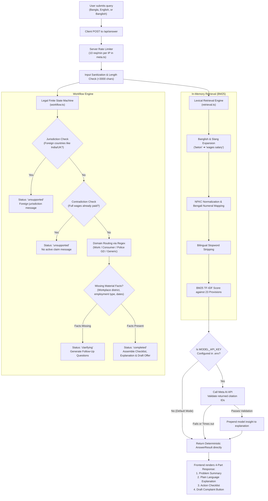

# MyLaws Website — Technical Analysis & Developer Handoff Specification

**Project**: MyLaws (Bangladesh Legal Information & Preparation Assistant)  
**Target Audience**: Software Engineers, Technical Leads, Product Managers  
**Date**: October 2026  
**Stack**: Next.js 15 (App Router), React 19, TypeScript 5.7, Tailwind CSS 3.4, jsPDF, Vitest  

---

## 1. Executive Summary & Core Concept

**MyLaws** is an accessible legal information and document preparation web application designed for citizens in Bangladesh facing everyday legal disputes (such as unpaid wages, threats/harassment, and consumer fraud).

### The Core Architectural Dilemma
In legal tech, standard generative AI (LLMs) often **hallucinate**: they invent non-existent penal sections, hallucinate court deadlines, or give legally dangerous procedural advice. 

To solve this, MyLaws implements a **Hybrid Deterministic Architecture**:
1. **The System Works Fully Without Any External API**: It does not depend on an external AI API (like OpenAI, Meta, or Anthropic) or external database to function.
2. **Deterministic Legal Ground Truth**: Queries are analyzed using an in-memory rule-based Finite State Machine (FSM) combined with a BM25 lexical retrieval engine over 23 human-verified statutory provisions from official Bangladesh gazettes (`bdlaws.minlaw.gov.bd`).
3. **Optional Model Enrichment**: If an external API key (`MODEL_API_KEY`) is configured, an LLM layer can enrich the explanation, but its citations are strictly filtered and validated against the verified statutory corpus. If the API fails or is missing, it falls back to the deterministic engine seamlessly.

---

## 2. System Architecture & Project Structure

The project is structured as a full-stack Next.js 15 application utilizing the App Router and a Backend-For-Frontend (BFF) pattern:

```
mylaws-website/
├── public/                 # Static assets, fonts, transparent 3D render frames
├── src/
│   ├── app/                # Next.js App Router (Pages & API Routes)
│   │   ├── api/            # Server-Side BFF Endpoints
│   │   │   ├── answer/     # POST: Processes questions and builds legal workflows
│   │   │   ├── drafts/     # POST: Assembles formal complaint/GD documents
│   │   │   ├── manifest/   # GET:  Returns legal pack & release metadata
│   │   │   ├── offices/    # GET:  Queries verified government office directory
│   │   │   ├── sources/    # GET:  Full-text search on statutory provision library
│   │   │   └── status/     # GET:  Operational health & API configuration status
│   │   ├── ask/            # Interactive Online Assistant (/ask)
│   │   ├── drafts/         # Bangla Legal Complaint / GD Editor & PDF preview (/drafts)
│   │   ├── download/       # Real Android APK download & release manifest (/download)
│   │   ├── sources/        # Searchable statutory provisions library (/sources)
│   │   ├── layout.tsx      # Root layout (fonts, global styles)
│   │   └── page.tsx        # Product Landing Page / Case Sheet Showcase
│   ├── components/         # Reusable UI components
│   │   ├── AppContext.tsx  # Bilingual context (Bangla 'bn' / English 'en'), theme
│   │   ├── CasePreview.tsx # Interactive Hero case folder (Checklist / Source / Draft)
│   │   ├── Checklist.tsx   # Action checklist with toggleable completion states
│   │   ├── SourceDrawer.tsx# Side drawer for verbatim statutory excerpts
│   │   ├── OfficeModal.tsx # Verified office directory modal (hotlines, addresses)
│   │   └── LadyJustice.tsx # Interactive canvas/scroll 3D statue renderer
│   ├── data/               # Authored In-Memory Ground Truth
│   │   ├── legal.ts        # 23 verified statutory provisions across 6 Acts
│   │   ├── offices.ts      # Directory of verified legal aid, police & labour offices
│   │   └── manifest.ts     # Release manifests and legal pack versions
│   ├── lib/                # Core Business Logic & Algorithms
│   │   ├── retrieval.ts    # BM25 search, Banglish normalizer, tokenization
│   │   ├── workflow.ts     # Legal Finite State Machine, guardrails, action checklist
│   │   ├── drafts.ts       # Document templating, fact validation, text assembly
│   │   ├── meta.ts         # Optional Meta AI caller, rate-limiter, citation validator
│   │   └── pdf.ts          # High-DPI canvas text rasterization for Bengali ligatures
│   └── types/
│       └── contracts.ts    # Strict TypeScript contracts (100% parity with Android app)
└── tests/                  # Vitest Automated Test Suites (23 tests)
```

---

## 3. End-to-End Query Analysis & Answering Pipeline

Below is the exact execution flow when a user submits a query on the `/ask` page:



---

## 4. Key Subsystems Explained in Detail

### 4.1 In-Memory Retrieval Engine (`src/lib/retrieval.ts`)
The retrieval engine does not use vector embeddings or external vector databases. Instead, it implements a highly optimized, domain-specific BM25 search:
1. **Banglish Normalization**: Transliterations such as `amr`, `beton`, `deynai`, `krbo`, `thana`, `jomi` are detected via regex and expanded with English and Bengali legal synonyms (`beton` $\rightarrow$ `wages salary unpaid employment`).
2. **Numeral Normalization**: Maps Bengali digits (`০-৯`) to standard digits (`0-9`).
3. **BM25 TF-IDF Ranking**: Evaluates query tokens against the pre-indexed terms of the 23 provisions:
   $$\text{Score}(D, Q) = \sum_{i=1}^n \text{IDF}(q_i) \cdot \frac{f(q_i, D) \cdot (k_1 + 1)}{f(q_i, D) + k_1 \cdot (1 - b + b \cdot \frac{|D|}{\text{avgdl}})}$$
   Matches with full keyword phrases receive an additional $+3.0$ score bonus.

### 4.2 Legal Workflow Engine & State Machine (`src/lib/workflow.ts`)
Legal disputes require factual preconditions before statutory rights apply:
- **Status States**:
  - `ready`: Default initial state.
  - `submitted` / `finding_sources`: Intermediate UX states while processing.
  - `clarifying`: When the engine identifies the dispute type (e.g., unpaid wages under Labour Act 2006) but lacks material facts (e.g., workplace district or whether the firm is in an EPZ or private sector). It returns structured questions back to the user.
  - `completed`: When all facts are present, it compiles the full Action Checklist, problem summary, plain language rights, and draft offer.
  - `unsupported`: When outside Bangladesh jurisdiction or contradictory.
- **The Canonical 4-Part Legal Response**:
  1. `problemSummary`: Formal classification of the issue (e.g., *"Unpaid Wages & Statutory Labour Rights Violation"*).
  2. `plainLanguageExplanation`: Exact statutory explanation in simple terms (e.g., Section 123 requires wage settlement within 7 working days; Section 45 penalizes failure to deliver ordered goods).
  3. `checklist`: 3–5 actionable steps with document badges, evidence guidelines, and direct phone hotlines (DIFE `16104`, Consumer Protection `16121`, Legal Aid `16699`, Police `999`).
  4. `draftOffer`: One-click handoff to pre-fill an official formal complaint.

### 4.3 Structured Draft Generator & Bengali PDF Engine (`src/lib/drafts.ts` & `src/lib/pdf.ts`)
- **Supported Documents**:
  1. `dife`: Formal complaint addressed to the Inspector General of Labour (DIFE) under Section 124A/132.
  2. `gd`: General Diary (GD) application addressed to the Officer-in-Charge (OC) of the relevant police station.
  3. `dncrp`: Consumer dispute complaint to the Directorate of National Consumer Rights Protection.
- **Placeholders**: Fields that the user hasn't specified are preserved as explicit placeholders (e.g. `[বর্তমান ঠিকানা / Address লিখুন]`) to prevent accidental submission of incomplete drafts.
- **Complex Bengali Script PDF Rendering**:
  Standard PDF libraries break Bengali ligatures (যুক্তাক্ষর) and vowel signs (কার). `src/lib/pdf.ts` uses an HTML5 Canvas text renderer that leverages the browser's native HarfBuzz/Blink text shaping with the `Noto Sans Bengali` font, converting pages into high-DPI rasterized A4 canvases before packaging into `jspdf`.

---

## 5. Current Implementation Status ("What Has Been Done")

| Category | Feature / Component | Status | Notes |
|---|---|---|---|
| **Frontend** | Showcase Hero with Interactive Case Folder | ✅ Complete | Live tabs for Checklist, Source, and Draft preview |
| **Frontend** | `/ask` Interactive Assistant | ✅ Complete | Finite State Machine, clarification modal, source drawers, office modals |
| **Frontend** | `/drafts` Document Editor | ✅ Complete | Editable fact fields, placeholder detection, status badges, print styling |
| **Frontend** | Bengali PDF Generator | ✅ Complete | 100% correct ligature shaping via Canvas + jsPDF; multi-page A4 wrapping |
| **Frontend** | `/sources` Legal Library Directory | ✅ Complete | Interactive search & category filter over 23 statutory provisions |
| **Frontend** | `/download` Android Release Page | ✅ Complete | Real APK delivery (10.3 MB), verified SHA-256 checksum and hardware specs |
| **Frontend** | Bilingual UI (`en` / `bn`) | ✅ Complete | Instant switching with Noto Sans Bengali typography |
| **Backend** | In-Memory BM25 Retrieval Engine | ✅ Complete | Banglish expansion, stopword removal, intent matching |
| **Backend** | Deterministic Legal Workflow Engine | ✅ Complete | Rule-based decision tree for Labour, Police GD, and Consumer disputes |
| **Backend** | Optional Meta AI Integration | ✅ Complete | Rate limited, circuit breaker fallback, strict citation validation |
| **Backend** | BFF Server Routes (`/api/*`) | ✅ Complete | Clean REST contracts matching Android Kotlin contracts |
| **Testing** | Automated Test Suite | ✅ Complete | 23 passing tests in Vitest covering retrieval, workflow, drafts, and API security |

---

## 6. What Needs to Be Done Next ("Developer Roadmap")

A new developer taking over this project should focus on the following high-priority areas:

### 1. Database & Persistence Layer (Currently In-Memory & Session Storage)
* **Current State**: User answers and drafted documents exist only in React state and browser `sessionStorage`. If the user refreshes or changes devices, data is lost.
* **Next Steps**:
  - Integrate a persistent database (PostgreSQL with Prisma/Drizzle, or Supabase).
  - Implement a `cases` table to store: `case_id`, `user_id` (or anonymous session token), `status`, `facts`, `checklist_progress`, and `draft_content`.
  - Ensure zero-knowledge or client-side encryption for sensitive legal narratives to maintain the project's strict privacy promise.

### 2. Expand the Statutory Corpus (Beyond the Current 23 Provisions)
* **Current State**: [`src/data/legal.ts`](file:///e:/vibe%20coding/POIDH/MyLaws%20Website/src/data/legal.ts) contains 23 provisions across 6 acts.
* **Next Steps**:
  - Add provisions for **Family Law** (Muslim Family Laws Ordinance 1961, Hindu Marriage Registration Act, dower/maintenance rules).
  - Add provisions for **Land & Property Disputes** (Specific Relief Act 1877 for eviction/possession, State Acquisition and Tenancy Act 1950).
  - Add provisions for **Cybercrime** (Cyber Security Act / digital harassment remedies).
  - Store provisions in a structured database or JSON repository with automated validation scripts.

### 3. Dynamic Fact Extraction via LLM (Hybrid AI Enhancement)
* **Current State**: Fact extraction from the initial prompt uses regex keywords (`isWorkQuestion`, `isGdQuestion`). Open-ended, conversational queries that mix multiple facts (e.g. *"My boss in Gazipur fired me on the 10th and owes me 40,000 taka"*) do not automatically populate the `workplace`, `amount`, and `date` fields in the draft.
* **Next Steps**:
  - Add an LLM-based entity extractor in `/api/answer` (when `MODEL_API_KEY` is provided) to automatically extract:
    - `incidentDate`, `location`, `employerName`, `unpaidAmount`, `employmentType`.
  - Populate these directly into `request.facts` so the user skips manual clarification questions.

### 4. Provide Configured LLM Provider Flexibility
* **Current State**: [`src/lib/meta.ts`](file:///e:/vibe%20coding/POIDH/MyLaws%20Website/src/lib/meta.ts) is specifically coded to target Meta AI's REST endpoint (`https://api.meta.ai/v1/responses`).
* **Next Steps**:
  - Implement an adaptable LLM provider interface (supporting Gemini, OpenAI, Claude, or local Ollama/vLLM instances).
  - Add standard streaming responses (`ReadableStream`) for smoother conversational UX if real-time LLM commentary is enabled.

### 5. Expand Document Templates in `/drafts`
* **Current State**: Implemented templates are `dife` (Labour complaint) and `gd` (Police General Diary).
* **Next Steps**:
  - Implement the full template for `dncrp` (National Consumer Rights Protection formal petition).
  - Implement a `legal_notice` template (formal advocate legal notice for breach of contract or unpaid dues).
  - Implement a template for `land_registry` inspection petitions.

### 6. Production Deployment & Cloud Infrastructure
* **Current State**: Runs locally on `npm run dev` / `npm run build` with Node.js 22.
* **Next Steps**:
  - Set up Dockerfile and Docker Compose for containerized deployment.
  - Set up CI/CD pipeline (GitHub Actions) for running `npm test` and linting on every push.
  - Deploy to Vercel, AWS ECS, or a private VPS.
  - Configure production environment variables (`MODEL_API_KEY`, rate limit thresholds).

---

## 7. Developer Quickstart Guide

To run, test, and inspect the project locally:

```bash
# 1. Clone repository & install dependencies
npm install

# 2. Run the automated test suite
npm test

# 3. Start local development server
npm run dev
# Server will start on http://localhost:3000

# 4. Verify API health status
curl http://localhost:3000/api/status
# Returns: {"status":"operational","configured":false,"provisionsCount":23,...}

# 5. Production build check
npm run build
npm start
```
